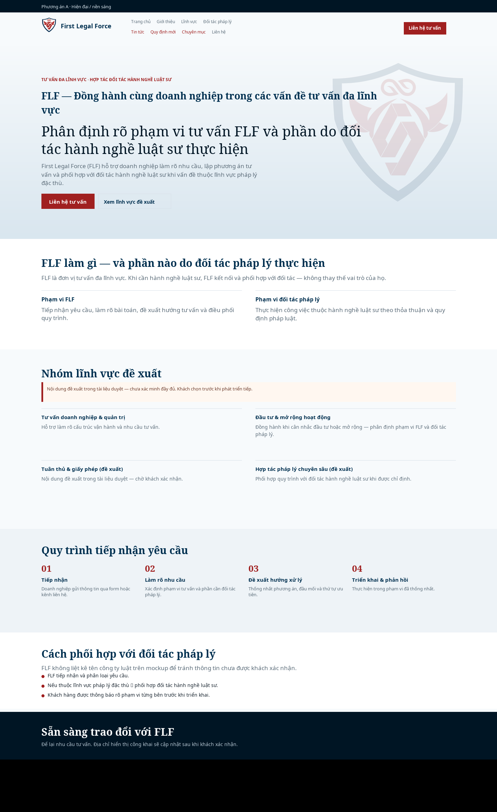
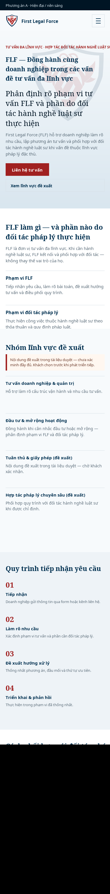
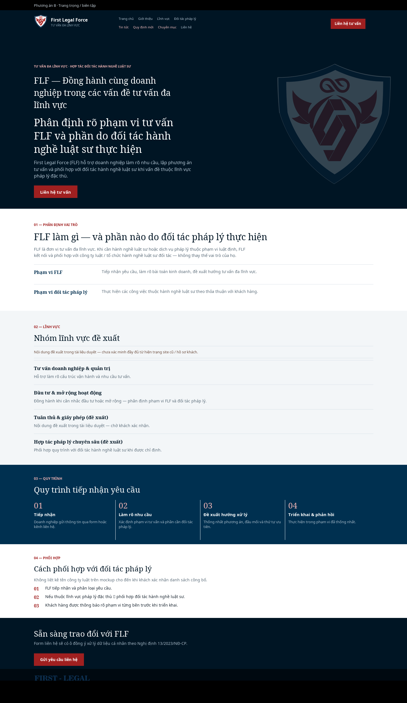
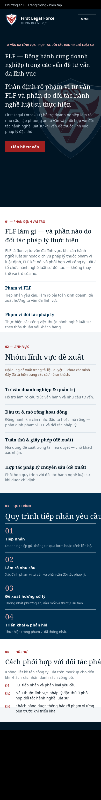

# Gợi ý mô tả Pull Request (dán vào PR)

## Summary

- Cập nhật preview thiết kế chờ duyệt (noindex): giữ A/B; bổ sung menu **Tin tức**, **Quy định mới**, **Chuyên mục** (danh sách + bài mẫu, bộ lọc minh họa, empty state).
- Bài Quy định mới có metadata số hiệu / cơ quan / hiệu lực / nguồn / người duyệt + nhãn dự thảo / chưa hiệu lực / đang hiệu lực (nội dung minh họa).
- Cập nhật sơ đồ trang và flow: nguồn → AI nháp → biên tập → duyệt → (luật sư đối tác) → lịch/xuất bản web → biến thể MXH → đăng kênh; lỗi MXH không mất bài web.
- Phân biệt rõ UI xem được vs AI/MXH giai đoạn 2. Không dựng CMS/backend; không đổi DNS flf.vn.

## URL preview

**Chưa có URL HTTPS công khai đã xác minh** ở lượt này (tunnel cũ không còn mặc định; Pages cần admin bật).

Xem local: `python3 -m http.server 4173` → http://127.0.0.1:4173/

Chi tiết: [`PREVIEW-URL.md`](PREVIEW-URL.md) · [`KIEM-TRA.md`](KIEM-TRA.md)

## Xem mockup trên GitHub

Trang so sánh: [`index.html`](../index.html)

| | Desktop 1440 | Mobile 390 |
|---|---|---|
| **A** |  |  |
| **B** |  |  |

- [Mockup A](../option-a/) · [Tin tức A](../option-a/tin-tuc/) · [Quy định mới A](../option-a/quy-dinh-moi/) · [Chuyên mục A](../option-a/chuyen-muc/)
- [Mockup B](../option-b/) · cùng cấu trúc mục

## Tài liệu

- [Sơ đồ trang & flow](SO-DO-TRANG.md)
- [Nội dung mẫu](NOI-DUNG-MAU.md)
- [Đề xuất chọn hướng](DE-XUAT-HUONG.md)
- [Biên bản kiểm tra](KIEM-TRA.md)

## Test plan

- [ ] `node scripts/check-pages.mjs` → PASS
- [ ] Mở `index.html`, option-a/b, tin-tuc, quy-dinh-moi, chuyen-muc (desktop + ~390px)
- [ ] Bộ lọc Chuyên mục «Quản trị rủi ro» → empty; quay lại danh sách từ bài mẫu
- [ ] Không có liên kết chết trong menu mục; noindex + banner chờ duyệt
